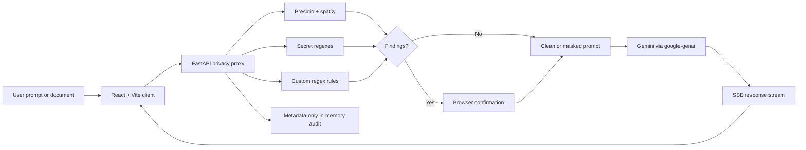

# Aegis AI

## A privacy proxy for safer AI work

**Aegis AI** is a privacy-first AI workspace built by **Team Celestial Devils**. It screens prompts and documents in the Aegis backend, replaces detected sensitive values with semantic placeholders, and sends only the protected prompt to Gemini.

> **Core promise:** Gemini receives the protected version of a prompt—not the original private value.

This document is the project README and a technical whitepaper for the current implementation. It describes what the repository does today; future work is marked as roadmap.

---

## 1. Executive summary

Most AI assistants send user text directly to a hosted model. Aegis inserts a privacy boundary before that model request:

1. The user writes a prompt or uploads a document.
2. Aegis analyzes it with Microsoft Presidio, spaCy, deterministic secret patterns, and optional custom regular expressions.
3. Detected values become typed placeholders such as `<PERSON>`, `<EMAIL_ADDRESS>`, or `<PHONE_NUMBER>`.
4. The browser shows findings and asks for confirmation when protected content exists.
5. Only the masked prompt is sent to Gemini.
6. The response remains placeholder-safe; Aegis does not de-mask it.
7. Only categories, counts, timestamps, sensitivity, and expiry are retained in the temporary audit store.

The project is local-first for the privacy decision. It has no authentication, database, durable compliance storage, or multi-user workspace.

---

## 2. Product capabilities

### Privacy protection

- Standard, strict, and custom protection profiles.
- Presidio Analyzer with the English spaCy `en_core_web_sm` model.
- Standard entities: `PERSON`, `EMAIL_ADDRESS`, `PHONE_NUMBER`, `CREDIT_CARD`, and `LOCATION`.
- Strict entities: standard entities plus `IP_ADDRESS`, `URL`, `DATE_TIME`, `US_SSN`, `IBAN_CODE`, and `NRP`.
- Strict secret detection for API keys, access tokens, bearer tokens, password assignments, and private/local URLs.
- Custom regular-expression rules with a user-defined label; maximum 20 rules per request.
- Overlap resolution so a value is masked once.
- Confirmation before sensitive chat content is sent.
- No raw sensitive values in the audit log.
- No response de-masking.

### AI workspace

- Gemini through the `google-genai` SDK.
- Server-sent event (SSE) streaming for incremental replies.
- Configured-model-first fallback to `gemini-flash-lite-latest` and `gemini-flash-latest`.
- Placeholder-preserving model instructions.
- Browser-local conversation persistence using `localStorage`.
- Conversation title editing, archive/unarchive, new, restore, and delete controls.
- Regenerate, shorten, clarify, and formalize actions.
- Prompt suggestions and templates for email, contract analysis, customer support, code review, and document summaries.

### Document protection lab

- PDF, DOCX, CSV, PNG, JPG/JPEG, WEBP, BMP, and GIF input.
- 10 MB upload limit.
- Local extraction before privacy analysis.
- PDF extraction with `pypdf`.
- DOCX paragraph/table extraction with `python-docx`.
- CSV parsing with Python's standard `csv` module.
- Image OCR through Pillow and Tesseract via `pytesseract`.
- Original/masked side-by-side previews.
- Protected-item count and category display.
- Safe plain-text redacted export.
- Analysis-only operation; documents are not automatically sent to Gemini.

### Interface

- React 19 and Vite.
- Tailwind CSS 4 with a custom cosmic theme.
- Glassmorphism surfaces, squircle corners, orbital/eclipse threat indicator, layered gradients, and responsive layouts.
- Lucide React icons.
- Space Grotesk, Manrope, and DM Mono typography roles.
- Accessible labels for key controls, dialogs, uploads, and message input.

---

## 3. Privacy model and trust boundary

| Stage | Data | Destination |
| --- | --- | --- |
| 1. Input | Original prompt or extracted document text | Browser → Aegis backend |
| 2. Detection | Entity spans and categories | Aegis backend memory |
| 3. Masking | Original values become placeholders | Aegis backend memory |
| 4. Confirmation | Categories and count | Browser |
| 5. Model request | Masked prompt only | Aegis backend → Gemini |
| 6. Response | Gemini reply with placeholders | Browser |
| 7. Audit | Categories, count, time, sensitivity, expiry | Temporary backend memory |

The private-value map exists only inside the masking operation and is not returned by the API. The application does not reconstruct original values in Gemini responses.

### Boundary conditions

- The original prompt reaches the Aegis backend for scanning. This is a privacy proxy, not a browser-only scanner.
- CORS currently allows all origins for local development; production must restrict it.
- There is no authentication or authorization.
- Browser history is unencrypted in the current browser profile.
- Gemini can infer information from context even when literal values are masked.
- Recognizers are heuristic and cannot guarantee complete detection.

---

## 4. System architecture



| Process | Responsibility | Default address |
| --- | --- | --- |
| Vite | Serves and hot-reloads React | `http://127.0.0.1:5173` |
| Uvicorn/FastAPI | Scans, masks, extracts, audits, calls Gemini | `http://127.0.0.1:8000` |
| Gemini | Generates from the masked prompt | External Google AI service |

There is no application database. The frontend uses JSON REST, multipart upload, and SSE.

---

## 5. Repository structure

```text
AegisAI/
├── README.md                         # This whitepaper and operator guide
├── .vscode/tasks.json                # Background launch tasks
├── backend/
│   ├── .env                          # Local secrets; never commit
│   ├── requirements.txt              # Pinned Python environment
│   ├── test_models.py                # Gemini model discovery helper
│   └── app/
│       ├── main.py                   # FastAPI app, schemas, routes, audit store
│       ├── api/                      # API namespace; active routes are in main.py
│       ├── core/config.py             # Reserved configuration module
│       ├── models/schemas.py          # Reserved model module
│       └── services/
│           ├── presidio_engine.py    # Detection and masking
│           ├── document_service.py   # File extraction
│           └── llm_service.py        # Gemini and streaming
├── frontend/
│   ├── package.json                  # Scripts and direct dependencies
│   ├── package-lock.json             # Locked npm dependency graph
│   ├── vite.config.js                # React/Vite integration
│   ├── postcss.config.js             # Tailwind/PostCSS integration
│   ├── tailwind.config.js            # Content scan paths
│   └── src/
│       ├── main.jsx                  # React entry point
│       ├── App.jsx                   # Shell and threat indicator
│       ├── index.css                 # Theme and global styles
│       ├── components/ChatBox.jsx    # Chat, consent, settings, audit
│       ├── components/DocumentScanner.jsx
│       └── services/api.js            # REST, SSE, upload client
└── frontend/public/                  # Favicon and static icon assets
```

---

## 6. Backend design

### FastAPI application

`backend/app/main.py` exposes the active routes, configures development CORS, validates requests with Pydantic 2, manages the in-memory audit store, and coordinates privacy, document, and LLM services.

Validation limits:

- Prompt: 1–12,000 characters.
- Sensitivity: `standard`, `strict`, or `custom`.
- Retention: 5, 15, 30, or 60 minutes.
- Custom label: 1–32 characters.
- Custom pattern: 1–300 characters.
- Custom rules: maximum 20.
- Session ID: 1–100 characters.

### Detection and masking

`presidio_engine.py` initializes Presidio with spaCy and disables tldextract's network-backed suffix-list lookup. It selects the entity profile, runs Presidio, applies secret/custom patterns, rejects overlaps, replaces spans right-to-left, and returns `masked_text`, a private `pii_map`, and public `findings`. The map never leaves the backend operation.

### Secret patterns

| Category | Shape detected |
| --- | --- |
| `API_KEY` | `sk`, `pk`, `rk`, or `AIza` followed by a long token |
| `ACCESS_TOKEN` | GitHub/Slack prefixes such as `ghp`, `github_pat`, `xoxb`, `xoxp` |
| `BEARER_TOKEN` | `Bearer` followed by a token |
| `PASSWORD` | `password: value`, `passwd=value`, or `pwd=value` |
| `PRIVATE_URL` | localhost, loopback, and private IPv4 URLs |

### Gemini service

`llm_service.py` loads `.env`, creates a client only when `GEMINI_API_KEY` exists, and uses `GEMINI_MODEL` or `gemini-flash-lite-latest`. Every request instructs Gemini to preserve placeholders. Calls try the configured model, `gemini-flash-lite-latest`, then `gemini-flash-latest`. Missing keys and total model failure produce safe local fallback messages.

### Document extraction

Uploads are read in memory, restricted to supported extensions, limited to 10 MB, extracted, rejected when empty, and sent through the same masking engine. Image scanning requires both `pytesseract` and the system Tesseract executable.

### Audit lifecycle

The process-local `audit_store` maps session IDs to event lists and `audit_expiry` maps sessions to expiry timestamps. Cleanup runs opportunistically when routes are called. Events contain only ID, creation time, categories, count, sensitivity, and expiry. Restarting the backend clears them.

---

## 7. Frontend design

`App.jsx` provides the desktop sidebar, threat counter, status pills, document modal, and chat panel. `ChatBox.jsx` owns input, consent, streaming, settings, history, audit controls, and response actions. Placeholder text is rendered as animated redaction chips.

The current conversation is stored under `aegis-current-conversation`; history is stored under `aegis-conversation-history`. This content remains in the browser unless the user sends a prompt.

`DocumentScanner.jsx` handles file selection, scan settings, original/masked previews, errors, and redacted text download. `api.js` uses Axios for JSON/audit requests and Fetch for SSE/multipart requests.

Tailwind CSS 4 is loaded through `@tailwindcss/postcss`. Global CSS defines color tokens, glass surfaces, gradients, orbital animation, redaction animation, focus states, reduced-motion behavior, and responsive popover anchoring.

---

## 8. API reference

All routes use the `/api` prefix.

### `POST /api/scan`

Scans without calling Gemini.

```json
{
  "prompt": "My email is priya@example.com",
  "sensitivity": "standard",
  "custom_rules": [],
  "retention_minutes": 30
}
```

Returns `masked_prompt`, `findings`, and `threats_blocked`.

### `POST /api/chat`

Scans, requires `confirmed: true` when findings exist, calls Gemini synchronously, records metadata, and returns `masked_prompt`, `llm_response_secured`, `findings`, `threats_blocked`, and `audit_event`. Unconfirmed sensitive content returns HTTP 409.

### `POST /api/chat/stream`

Uses the chat request contract and returns SSE events:

```text
event: meta
data: {"masked_prompt":"...","findings":[],"threats_blocked":0}

event: delta
data: {"text":"..."}

event: done
data: {"audit_event":{...}}
```

### `POST /api/documents/scan`

Accepts multipart fields `file`, `sensitivity`, and `custom_rules_json`. Returns filename metadata, original extracted text, masked text, findings, count, and `sent_to_model: false`.

### Audit routes

- `GET /api/audit/{session_id}` returns temporary metadata-only events and the baseline TTL.
- `DELETE /api/audit/{session_id}` clears a session's events.

Interactive FastAPI documentation is available at [http://127.0.0.1:8000/docs](http://127.0.0.1:8000/docs).

---

## 9. Configuration

Create `backend/.env` locally. Never commit it or expose the key in frontend code.

| Variable | Required | Default | Purpose |
| --- | --- | --- | --- |
| `GEMINI_API_KEY` | Only for live Gemini | None | Google Gen AI authentication |
| `GEMINI_MODEL` | No | `gemini-flash-lite-latest` | Preferred model |
| `AUDIT_TTL_SECONDS` | No | `1800` | Baseline TTL reported by audit API |
| `VITE_API_URL` | No | `http://127.0.0.1:8000/api` | Frontend API base URL |

`retention_minutes` controls event expiry and is currently separate from the reported `AUDIT_TTL_SECONDS` baseline.

---

## 10. Dependency inventory

### Python

The pinned backend environment uses Python 3.12, FastAPI, Uvicorn, Pydantic 2, Presidio Analyzer/Anonymizer, spaCy, `en_core_web_sm`, tldextract, google-genai, python-dotenv, pypdf, python-docx, lxml, Pillow, pytesseract, python-multipart, and the supporting Google auth, gRPC, cryptography, NumPy, requests, SQLAlchemy, and spaCy packages listed in `backend/requirements.txt`.

### JavaScript

The frontend uses React 19, react-dom, Vite 8, Tailwind CSS 4, `@tailwindcss/postcss`, autoprefixer, `@vitejs/plugin-react`, Axios, Lucide React, Oxlint, and React type packages. `package-lock.json` locks the complete npm graph.

### Optional system software

Tesseract OCR is required only for image scanning. Debian/Ubuntu installation:

```bash
sudo apt-get install tesseract-ocr
```

### Explicitly not used

No database, active ORM path, server-side conversation database, authentication provider, frontend Gemini SDK, or format-preserving redaction engine is present.

---

## 11. Installation and operation

### Prerequisites

- Node.js 20.19+ or current Node.js 22.
- npm.
- Python 3.12.
- Gemini API key for live model responses.
- Tesseract for image scanning.

### Backend

```bash
cd backend
python3.12 -m venv venv
source venv/bin/activate
pip install -r requirements.txt
```

Configure:

```env
GEMINI_API_KEY=your_gemini_api_key
GEMINI_MODEL=gemini-flash-lite-latest
```

Start from the repository root:

```bash
backend/venv/bin/uvicorn app.main:app --reload --app-dir backend --host 127.0.0.1 --port 8000
```

### Frontend

```bash
cd frontend
npm install
npm run dev -- --host 127.0.0.1 --port 5173
```

Open [http://127.0.0.1:5173](http://127.0.0.1:5173). VS Code also provides **AegisAI Backend** and **AegisAI Frontend** background tasks in `.vscode/tasks.json`.

---

## 12. Development commands

```bash
# frontend
cd frontend
npm run dev
npm run lint
npm run build
npm run preview
```

```bash
# backend
cd backend
source venv/bin/activate
python -m compileall -q app
uvicorn app.main:app --reload --host 127.0.0.1 --port 8000
python test_models.py                 # lists key-accessible Gemini models
```

---

## 13. Operational behavior and failure modes

- **No API key:** scanning works and chat returns a local screened-message fallback.
- **Gemini failure:** the service tries the configured model and two fallbacks, then returns a safe unavailable message.
- **OCR unavailable:** the API returns an explicit Tesseract error rather than treating the image as safe.
- **Unconfirmed sensitive content:** chat returns HTTP 409 and the UI opens consent.
- **Backend unavailable:** the frontend displays a scanner/channel error and does not send the prompt to Gemini.
- **Audit expiry:** expired sessions are removed when API routes trigger cleanup; there is no scheduler.

---

## 14. Security posture

### Controls currently present

- Masking occurs before the Gemini call.
- The model receives placeholders instead of recognized literal values.
- Sensitive sends require explicit confirmation.
- Audit entries exclude raw prompt text and detected values.
- The API key is backend-only.
- Uploads are capped at 10 MB.
- Private/local URLs can be detected in strict/custom profiles.
- OCR failure is explicit.

### Required before production

Restrict CORS, add authentication/authorization, require HTTPS, add rate limiting, use encrypted durable audit storage where required, use a secrets manager, validate uploads for malware/content risks, add structured security logging without secrets, review provider retention terms, and test recognizer coverage against organizational data.

---

## 15. Known limitations

- PDF/DOCX exports are plain-text rather than format-preserving.
- Image scanning requires Tesseract.
- English NLP is the configured path.
- Heuristics can miss unusual or domain-specific identifiers.
- Conversation history is browser-local and unencrypted.
- Audit storage is process-local and disappears on restart.
- Cleanup is request-triggered, not scheduled.
- No authentication, team workspace, role-based policy, or production rate limiting.
- CORS is permissive for local development.
- Gemini may infer facts from surrounding context.
- No formal automated unit, integration, or end-to-end test suite is configured.

---

## 16. Verification checklist

1. Run `npm run lint` in `frontend`.
2. Run `python -m compileall -q app` in the backend environment.
3. Test `/api/scan` with clean and sensitive prompts.
4. Test `/api/chat/stream` and verify `meta`, `delta`, and `done` events.
5. Verify unconfirmed sensitive chat returns HTTP 409.
6. Test document extraction and masked preview.
7. Verify the browser consent dialog and streaming reply.
8. Confirm no API key, raw prompt, or detected value appears in audit output or frontend source.

---

## 17. Roadmap

- Format-preserving PDF/DOCX redaction.
- Encrypted organization-scoped audit storage.
- Authentication, team workspaces, and role-based masking policies.
- Multilingual detection.
- Batch document scanning.
- Image redaction overlays and downloadable redacted images.
- Production observability, rate limiting, and structured security events.
- Automated unit, integration, browser, and security regression tests.
- More explicit provider privacy controls.

---

## Credits and final statement

Built by **Team Celestial Devils**.

Aegis AI is a privacy proxy and productivity interface for safer AI workflows. It reduces accidental disclosure by masking recognized values before model submission, but it is not a substitute for legal, regulatory, organizational, or specialized data-protection controls.
